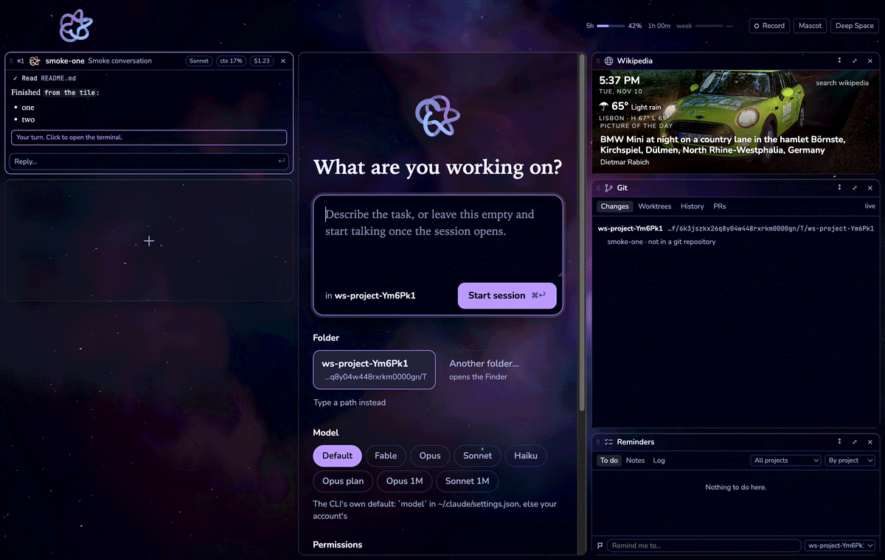
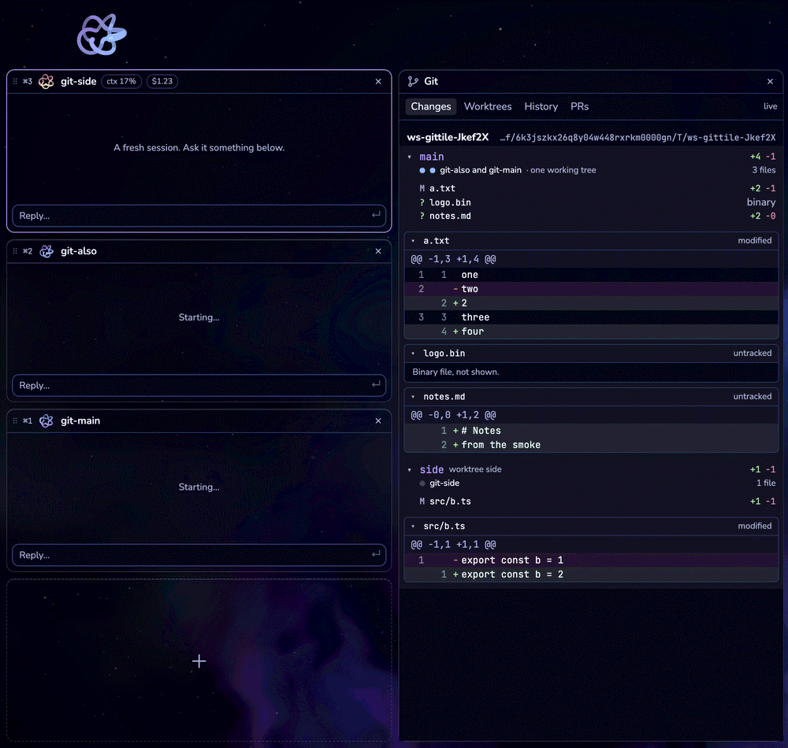

<p align="center">
  
</p>

**workshop** is a Mac app for people who use Claude Code and Codex: several sessions of either
side by side in one window, and a column of small apps beside them, called tiles, that anyone can
write, share and install. It is **macOS, Claude Code and Codex**, each CLI on your own plan. Other
platforms and other agent CLIs are welcome contributions, not launch scope.

**Build a tile:** a tile is a folder with a manifest and a web page. Press **+** at the foot of
the tile column and choose **Build a new tile**, and workshop starts a session that builds one with
you. The [tile section](#build-a-tile) below has the whole recipe.

Open source under MIT, by [DoshaLabs](https://github.com/DoshaLabs). Project page and
marketplace: [doshalabs.github.io/workshop](https://doshalabs.github.io/workshop/).

---

## Why

Most coding-agent tools are session managers: several sessions in one window. Anthropic's own
desktop app does that now, and does it well. Workshop does it too, and then gives the rest of the
window to **tiles**: small apps that sit beside your sessions and that anyone can write.

A tile is a folder with a manifest: you drop it in and it runs. People share them, list them in
one open [marketplace](https://doshalabs.github.io/workshop/#marketplace), and the best ones get
used by everyone. Workshop wants that for the desktop you code in. Designing a tile is fun, and
that fun is the point.

<p align="center">
  
</p>
<p align="center"><sub>From the app's own test run, in Deep Space. Wikipedia's picture of the day: <a href="https://commons.wikimedia.org/wiki/File:D%C3%BClmen,_Kirchspiel,_BMW_Mini_--_2016_--_5065-71.jpg">BMW Mini at night in Dülmen</a> by Dietmar Rabich, <a href="https://creativecommons.org/licenses/by-sa/4.0">CC BY-SA 4.0</a>, so this screenshot is CC BY-SA 4.0 too.</sub></p>

## What is in it today

Workshop runs from source, and `npm run install-app` builds the Mac app from it. There is **no
download or installer yet**; that is next on the [roadmap](#roadmap). Tiles from the
[marketplace](https://doshalabs.github.io/workshop/#marketplace) install from the + menu.

- **Sessions.** Each one is the real `claude` or `codex` command, unchanged, in its own tmux
  session, so it keeps running when you quit. The left column shows each session's conversation
  as it happens, with its context use (and cost, for Claude Code), and the Knot showing whether it
  is working or waiting for you. The session you are on fills the middle as a terminal. Start one
  in a folder or a fresh worktree; park it and resume it later; switch with ⌘1 to ⌘9.
- **Codex, beside Claude Code.** If `codex` is installed, the new-session form offers it with its
  own modes. A Codex session gets what a Claude one does: its conversation on its tile, its
  approvals as cards, its subagents in the pack, its commits tagged in Git, and your tiles as
  tools. Where Claude Code has ⏸ pause, Codex has ■ Stop, since Codex cannot hold a call from
  outside.
- **Permission prompts on the tile.** When a session asks before running a command, editing a
  file or calling a tool, the question shows on its tile with Allow and Deny. The terminal can
  still answer; whichever answers first wins.
- **Subagents.** A session's subagents and helper sessions sit in one pack tile under it, each
  conversation live, with kill (and, for Claude Code, pause) one click away.
- **Usage.** The rate-limit windows across the top: Claude's 5-hour and weekly, and, once a Codex
  session has reported them, your Codex plan's windows beside them, each labelled by its length.
- **Tiles.** The right-hand column. Built in today: **Git** (every session's changes and diffs,
  and every worktree with rebase, merge and remove behind two clicks), **Reminders** (to-dos, notes
  and a log by project, which sessions can write to) and **Wikipedia** (the picture of the day, a
  clock and the weather, and search). Any tile can open large in the middle.
- **Your own tiles.** Build one with a session, load a folder you are working on, or install one
  from a git repository at a pinned commit.
- **Themes.** Deep Space, the default, with its live star field, and seven others.

<p align="center">
  
</p>

## Run it from source

You need:

- a Mac
- Node 22 or later (the build uses Vite 7, which wants 20.19+ or 22.12+)
- tmux (`brew install tmux`)
- [Claude Code](https://docs.anthropic.com/en/docs/claude-code), installed and logged in
- optionally [Codex](https://github.com/openai/codex) (`npm i -g @openai/codex`), logged in; the
  new-session form offers it once it is on your PATH

```sh
git clone https://github.com/DoshaLabs/workshop
cd workshop
npm install
npm run dev
```

`npm run dev` uses its own profile (`workshop-dev`), so it never sees the sessions of another copy
of workshop. Other scripts: `npm test` (unit tests), `npm run typecheck`, and `npm run smoke`, which
builds the app and drives it end to end with a stand-in `claude` and `codex` and a throwaway
profile.

## Build a tile

A tile is a folder:

```
focus-timer/
  tile.json          the manifest
  dist/index.html    the page: plain HTML, CSS and JS, or anything you build yourself
  icon.svg           optional, 16 × 16, drawn in the tile's head
  plugin/            optional: skills that teach a Claude session to use the tile
```

The page is built **before** you share it. Nothing is ever built on the user's machine.

### The quick way

Press **+** at the foot of the tile column, open **Yours**, and fill in **Build a new tile**: a name,
and what it should do. Workshop copies a working starter into `~/workshop-tiles/<id>`, loads it, and
starts a session there to build it with you. The tile reloads every time a file changes. The
starter's [`template/CLAUDE.md`](template/CLAUDE.md) is the whole contract, written for the Claude
that builds it, and the best reference for you too.

### From the shell

```sh
node bin/workshop.mjs tile dev ./focus-timer     # load it; reloads on change, or point "entry" at a dev server
node bin/workshop.mjs tile check ./focus-timer   # the same checks workshop runs before it loads a tile
```

`tile check` exits 0 if the tile will load, and says what to fix if not. Add `--json` for a
report a script can read.

### A whole tile

A 25-minute timer that keeps its end time in storage and sends a notification when it is done.

`tile.json`:

```json
{
  "id": "focus-timer",
  "name": "Focus timer",
  "version": "0.1.0",
  "workshop": "^1",
  "author": "you",
  "hint": "Twenty-five minutes, then a break",
  "entry": "dist/index.html",
  "permissions": {
    "storage": true,
    "notify": true
  }
}
```

`dist/index.html`:

```html
<!doctype html>
<html lang="en">
  <head>
    <meta charset="utf-8" />
    <meta http-equiv="Content-Security-Policy" content="default-src 'none'; font-src 'self'; style-src 'self'; script-src 'self'" />
    <link rel="stylesheet" href="tile.css" />
  </head>
  <body>
    <p id="left">25:00</p>
    <button id="go">Start</button>
    <script type="module" src="tile.js"></script>
  </body>
</html>
```

`dist/tile.js`:

```js
const ws = window.workshop
const left = document.getElementById('left')
const go = document.getElementById('go')

// The end time survives a reload because it is kept in the tile's storage.
let end = await ws.storage.get('end')

function tick() {
  const ms = end ? end - Date.now() : 25 * 60_000
  if (end && ms <= 0) {
    end = null
    ws.storage.set('end', null)
    ws.notify({ text: 'Time for a break' })
  }
  const s = Math.max(0, Math.round(ms / 1000))
  left.textContent = `${Math.floor(s / 60)}:${String(s % 60).padStart(2, '0')}`
  go.textContent = end ? 'Stop' : 'Start'
}

go.onclick = async () => {
  end = end ? null : Date.now() + 25 * 60_000
  await ws.storage.set('end', end)
  tick()
}
setInterval(tick, 1000)
tick()
```

`dist/tile.css` can use the theme's colours and workshop's fonts, which every tile gets as CSS
variables: `var(--ws-panel)`, `var(--ws-ink)`, `var(--ws-accent)`, `var(--ws-font)` and the rest.
That folder passes `tile check` as it stands (with two warnings: no icon, and no `repo` yet).

### Letting a session use your tile

Declare ops under `permissions.door` and answer them in the page with `workshop.door.handle`. Any
session workshop starts can then call your tile. A Claude Code session calls it from the shell.
If the timer declared
`"door": { "ops": ["start"] }`:

```sh
node "$WORKSHOP_TILE" focus-timer start 25
```

```js
workshop.door.handle('start', async ([minutes], caller) => {
  end = Date.now() + Number(minutes || 25) * 60_000
  await workshop.storage.set('end', end)
  return { started: true, by: caller }
})
```

Put a skill in the tile's `plugin/` folder to teach sessions when to do that. It is an ordinary
Claude Code plugin, limited to skills.

A Codex session gets the same tile as an MCP tool, `focus-timer`, taking `{ "op": "start", "args":
["25"] }`, with your skill's words as its description. Codex asks before each call, and that
question shows on the session's tile too. The call goes through the same door, so the same
checks hold: only declared ops, only while the tile is on, and the caller is the session.

## The sandbox

Tiles from strangers are untrusted code, so each one runs in its own sandboxed web page, on its
own origin, with its own storage. It has no Node, no file system and no network. Everything it
can do goes through one object, `window.workshop`, and everything beyond the basics is a
permission named in the manifest and shown to the user before the tile runs. An unknown
permission is refused, not ignored.

| Permission | What it grants |
|---|---|
| `storage` | `workshop.storage`: one JSON store for the tile, up to 5 MB, written atomically |
| `net: ["api.example.com"]` | https and wss to exactly these hosts. No IPs, no `localhost`, no bare `*` |
| `sessions: "read"` | The list of sessions (Claude Code and Codex): name, project, status, which one is focused |
| `sessions: "launch"` | Also opens the new-session form, filled in. You press Start |
| `sessions: "write"` | Also types into a session |
| `usage` | The rate-limit windows, and each session's cost and context use |
| `door` | Sessions may call the ops it lists (from the shell, or as an MCP tool in Codex) |
| `notify` | A chip on the tile's head and a macOS notification; with `attention: true`, a jump of the session's Knot |
| `files` | Read-only access to what the user picks for it in the macOS chooser |
| `camera`, `microphone` | Passed through to the macOS prompt |
| `overlay` | The page laid over the whole window for a moment, after a click; Esc always closes it |
| `music` | What Spotify or Music is playing, and play, pause, skip, seek, volume |

The network rule is enforced in the main process, not in the page: anything undeclared goes
nowhere, WebRTC and DNS side doors included.

### Two tiers

| Tier | What it is | Who may use it |
|---|---|---|
| **Sandboxed** | The page and the bridge, nothing else | Every tile |
| **Trusted** | Adds a `backend.mjs`, a Node process with full access to the Mac | Only tiles that ship with workshop (Git, to run `git` and `gh`). Workshop refuses to load or install any other tile that declares one |

Keeping nearly every tile in the sandbox, and making the exception loud and rare, is how a
marketplace of other people's code stays safe to use.

## The Knot, and sprite packs



Workshop's mark is **the Knot**: a cinquefoil, the (2,5) torus knot, turning in 3D with a bright
pulse riding its strand. It sits on every session and at the top left of the window, and its
size, speed and colour say what that session is doing:

| Status | The Knot |
|---|---|
| Working | Full size, fast |
| Needs you | Nearly full size, slower, in the theme's alert colour |
| Starting | Smaller, steady |
| Idle | Small and slow |
| Ended | Still, and dimmed |

Every colour it draws is checked against the theme's background for contrast. Under reduced
motion it holds still.

**Prefer a fox?** Any pixel-art sprite sheet can replace the Knot: the **Mascot** button in the
top bar opens a setup screen that guesses the sheet's grid and lets you map its rows to the poses.
It recommends **Foxtrot**, [Elthen's 2D Pixel Art Fox
Sprites](https://elthen.itch.io/2d-pixel-art-fox-sprites), which you download from Elthen yourself
(name your own price, $0 allowed) and drop in. The art is Elthen's, under his own licence, not
this project's: it may not be redistributed, used in anything blockchain-related, or used to
train AI. Workshop ships only the mapping of his layout and never contains or fetches the sheet.
Credit is not required, but he appreciates it, and so do we. Consider a tip.

## Roadmap

1. **The tile contract and sandbox.** Done.
2. **Our own tiles on the contract.** Reminders, Wikipedia and Git (Changes and Worktrees) done;
   Git's History and PRs tabs, Spend, Files and Posture next.
3. **The rest of sessions.** Done: permission prompts answered from a session's tile, subagents
   in a pack tile with pause and kill, and Codex sessions beside Claude Code ones.
4. **Something a stranger can install.** A packaged app, an install script, and a first-run
   tutorial that builds your first tile with you.
5. **The index.** Done: a public repository listing tiles at pinned commits, checked by CI, and
   a Marketplace tab in the app that reads it. The site is next.
6. **Rankings**, from an anonymous install counter you can turn off. Anything hosted beyond that
   only if people are actually building tiles.

## Contributing

Issues and pull requests are welcome. Some ground rules shape what gets merged:

- The CLIs are never wrapped, forked or patched. A session is the unchanged `claude` or `codex`
  binary in a real terminal, and workshop only uses their own extension points: for Claude Code
  `--settings`, hooks, `--plugin-dir`, the status line and the transcript; for Codex its
  app-server, which the terminal and workshop both connect to, and `-c` options for that one
  session (nothing is written to your Codex config). Workshop never reads or proxies either CLI's
  credentials.
- Only truly open assets go in this repository: CC0, owned by DoshaLabs, or under a licence that
  allows redistribution in source form. "Free to use" is not enough.
- No games, ROMs, discs or BIOS files, ever, here or in any tile listing. Emulator tiles live in
  their own repositories and bring-your-own-games.
- Third-party tiles stay untrusted. New capabilities arrive as permissions in the contract, for
  every author, never as a private way in for one tile.
- Before a pull request: `npm run typecheck`, `npm test`, and `npm run smoke` (it must print
  0 failed).

[`CLAUDE.md`](CLAUDE.md) is the design: what was decided and why. [`docs/plan.md`](docs/plan.md) is
the work list.

## Licences

- Workshop is under the [MIT licence](LICENSE).
- Its fonts, [Nunito](assets/fonts/LICENSE-nunito.txt), [Source Serif
  4](assets/fonts/LICENSE-source-serif-4.txt) and [JetBrains
  Mono](assets/fonts/LICENSE-jetbrains-mono.txt), are under the SIL Open Font License; the
  licences are beside the files in `assets/fonts/`.
- The banner's lettering is Nunito, outlined (`scripts/wordmark.py`).
- Claude Code is Anthropic's, and Codex is OpenAI's. Workshop runs each as it is and is
  affiliated with neither.
